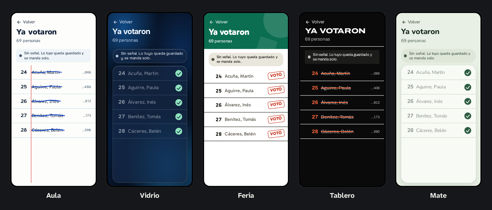

  

  <strong>The free app to organize your party's poll watchers, in any election.</strong> 
  Your data on your server. Works without signal. Anyone can use it, from the very first time.

  
  
  
  

---

## Why it exists

Elections are also won at the tables: someone has to be there, know who voted, report when something goes wrong and watch the
count until the end. Today, doing that well takes a structure only big parties have, and that is an advantage that should not
exist.

I am building Urna Abierta to break the monopoly of old political machines over election monitoring: so that a student group or a
small party only needs a free app, its own server and a little setup time. It is a personal project of mine, and it does not
belong to any party or group.

## Made for someone who has never opened it

No menus: one question per screen, one main button and a plan that tells you what comes next. Each person
sees only their work.

| Who | What they do |
|---|---|
| **Poll watcher** | Joins with a link, crosses out voters even without signal, counts envelopes each night and enters the count |
| **District chief** | Sees first the tables that need them, and calls with one tap |
| **Administration** | Sets up the party and the team once, and creates an election whenever needed |
| **Traffic light and statistics** | With separate permissions: one notes one person at a time, the other sees only numbers, never names |

  

With themes for every taste, in light and dark mode: you choose with a preview when installing, and each person can change it the first
time they open it. You can also add your own, with your party's colors. You can go through
[the design proposal](design/index.html) by opening it in your browser.

## What makes it different

- **Your data is yours.** Each party uses its own server. The project hosts nothing and receives nothing: no central server, no
  telemetry.
- **Works without signal.** Many classrooms have no connection. Everything is saved on the phone first and sent when it returns.
- **Designed not to pay for a server.** It aims at free tiers: I measured it within the limits of those machines, 1 GB of memory and a
  quarter of a processor, and it worked with 200 tables, in a [lab test](docs/en/stage-4-results.md).
- **Reads your rolls.** It reads a scanned PDF with a model that runs on your computer, without sending the roll to anyone.
- **With Argentine law in mind.** It brings permissions, a log nobody can change and tools to handle requests from people and erase the data at the end.

## Installation

You download an installer for Windows, macOS or Linux that asks you three questions, creates your server and leaves everything set up.

**There is no published version yet.** Meanwhile it can run from the source code, with invented people or with the installer itself:
**[how to install it](docs/en/installation.md)**. Before using it in an election, run a [drill](docs/en/drill.md).

## Status

The first real test is a university election, in April 2027.

- [x] Poll watcher view without signal, and sync without losses
- [x] Local reading of scanned rolls
- [x] Server measured on a small machine
- [x] Design proposal and theme system
- [x] Login, real rolls, tables and permissions
- [x] Irregularities, envelope count, vote count and chief panel
- [x] Traffic light, audit, personal data and backups
- [x] Installer, tested over SSH on Ubuntu and restoring a backup on another server
- [ ] Creating servers on the real clouds: tested against simulations of their APIs
- [ ] Test on a real iPhone
- [ ] Drill with real people

## Documentation

| | |
|---|---|
| [Installation](docs/en/installation.md) | The installer, and how to try it |
| [Creating a server](docs/en/servers.md) | Oracle, AWS and Google, step by step, and how to maintain it |
| [Drill](docs/en/drill.md) | What to test with real people before an election |
| [Your own theme](docs/en/themes.md) | Your party's colors, as long as they can be read |
| [Technical plan](docs/en/technical-plan.md) | Architecture, sync, permissions and roll format |
| [Measurements](docs/en/stage-4-results.md) | What was tested and what it showed, with the [initial risks](docs/en/stage-1-results.md) |
| [Legal](LEGAL.en.md) | License, responsibilities and personal data |
| [Personal data](docs/en/personal-data.md) | What the law asks, how to register the database and how to handle each request with the app |
| [Roll scanner](https://github.com/bafif/urna-abierta-padrones) | The repository that converts rolls to the open format |

## Author

Made by me, **Bautista D. Fiori**. If you want to use it in your election or join in, write to me.

[LinkedIn](https://www.linkedin.com/in/b-d-fiori/) · [GitHub](https://github.com/bafif)

## License

[AGPL-3.0-or-later](LICENSE). You may use, modify and share it; if you offer a modified version over a network, you must also offer
its source.
