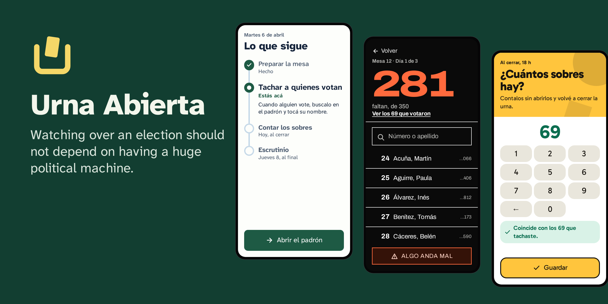

<div align="center">


# Urna Abierta

**The free app to organize your party's poll watchers, in any election.**<br>
[Español](README.md) · [Website](https://bafif.github.io/urna-abierta/en/) · [Install](#install) ·
[Your first election](docs/en/first-election.md)

</div>

Each party installs it on its own server. Poll watchers join with a link, cross out voters even without signal, report
when something goes wrong and enter the count with a photo of the tally sheet; the district chief sees first the tables
that need them. A free app, a server of your own and a little setup time are enough: it does not take the structure of
a big party.

<p align="center"></p>

## Why Urna Abierta

- **Your data, on your server.** Each party uses its own. The project hosts nothing and receives nothing: there is no
  central server and no telemetry.
- **Works without signal.** Everything is saved on the phone first and sent by itself when signal returns. If an urgent
  alert does not go out, the app offers to call the chief or write to them over WhatsApp or SMS.
- **Clear to someone who never opened it.** One question per screen, one main button and a plan that says what comes
  next. Each person sees only their work, in the theme and language they choose.
- **Designed not to pay for a server.** It aims at free tiers: with 1 GB of memory and a quarter of a processor, it
  handled 200 tables in a [lab test](docs/en/stage-4-results.md).
- **Reads your rolls.** An Excel or CSV spreadsheet uploads directly. A scanned PDF goes first through the
  [roll reader](https://github.com/bafif/urna-abierta-padrones), which reads it on your computer without sending it to
  anyone.
- **With Argentine law in mind.** Permissions per task, a log nobody can change and tools to handle people's requests
  and erase the data at the end. Complying with the law is still up to the party.

## Who does what

| Task | What they do |
|---|---|
| **Poll watcher** | Joins with a link, crosses out voters even without signal, counts envelopes each night and enters the count |
| **District chief** | Sees first the tables that need them, and calls their poll watcher with one tap |
| **Coordination** | Sets up the party and the team once, and creates an election whenever needed |
| **Traffic light** | Sets up the party's categories and places each person in one; every look at a sensitive one is logged |
| **Statistics** | Sees how many voted, never a name |

## Install

**There is no published version yet.** Once there is, the installer for Windows, macOS or Linux is downloaded from the
releases page: it asks three questions, creates your server and leaves everything set up.

Meanwhile, it can be tried from the source code, with Node 24 and Podman:

```sh
git clone https://github.com/bafif/urna-abierta && cd urna-abierta
corepack pnpm install
deploy/serve.sh        # the app with invented people: one link for each task
deploy/instalador.sh   # or the installer, to try it on this computer
```

[Installation](docs/en/installation.md) has the details: each installer option, how to load the roll and which server
to choose.

## How to use it

1. **Install it.** The installer asks where it will live (a new server on Oracle, AWS or Google, one you already have,
   a text to paste when creating it, or this computer), how to read the rolls and how it looks. At the end it gives you
   the address and a recovery key for the backups.
2. **Set up the party and the team.** The app greets you with a wizard. You add each person with their task and send
   them their link over WhatsApp or however you like.
3. **Create the election.** Days, lists, roll, tables and poll watchers, one step per screen.
4. **On election day,** poll watchers cross out voters and the panel shows first the tables that need something. At
   the end the count is entered, the election is closed and the personal data is erased.

The whole journey, and what to do when something fails, is in [Your first election](docs/en/first-election.md). Before
using it in a real election, run a [drill](docs/en/drill.md).

## Status

It is in development and has not been used in a real election yet.

- **Tested:** a whole election, end to end, on Android Chrome and on WebKit against the real server; an Android phone
  in an emulator, without signal, restarted and out of space; the server within the limits of a free tier; and the
  installation over SSH on Ubuntu, with backups, updates and restoring on another server.
- **Not tested yet:** creating servers on the real clouds (tested against simulations of their APIs), the certificate
  for an IP, installing on Linux distributions other than Ubuntu, the installer on real Windows and macOS (every change
  builds and starts it in continuous integration), a real iPhone and the drill with people. The details are in
  [What was tested, and what is left](docs/en/stage-4-results.md).

## More documentation

- [Installation](docs/en/installation.md): the installer, each option, loading the roll and which server to choose.
- [Creating a server](docs/en/servers.md): Oracle, AWS and Google step by step, backups, updating and restoring.
- [Your first election](docs/en/first-election.md): from installing to erasing the data, and what to do when something
  fails.
- [Drill](docs/en/drill.md): what to test with real people before an election.
- [Personal data](docs/en/personal-data.md): what the law asks, how to register the database and how to handle each
  request.
- [Legal information](LEGAL.en.md): license, responsibilities and personal data.
- [Your own theme](docs/en/themes.md): your party's colors, as long as they can be read.
- [Verify the download](docs/en/verify-download.md): the installer's SHA-256 and attestation.
- [Testing on a phone](docs/en/phone-tests.md): Android on an emulator, and the pending iPhone test.
- [Technical plan](docs/en/technical-plan.md): architecture, sync, permissions, roll format and stages.
- [What was tested, and what is left](docs/en/stage-4-results.md), with the [initial risks](docs/en/stage-1-results.md).
- [Releasing a version](docs/en/releasing.md): what GitHub Actions does with each version.
- [How to contribute](CONTRIBUTING.en.md): the tests, the languages and how the work is done.
- [Security](SECURITY.en.md): how to report a flaw, privately.
- [Design proposal](design/index.html): the screens of each task, to open in a browser.
- [Roll reader](https://github.com/bafif/urna-abierta-padrones): the repository that converts rolls to the open format.

## Author

Made by me, **Bautista D. Fiori**, as a personal project: it does not belong to any party or group. If you want to use
it in your election or join in, write to me: [LinkedIn](https://www.linkedin.com/in/b-d-fiori/) ·
[GitHub](https://github.com/bafif).

## License

[AGPL-3.0-or-later](LICENSE). You may use, modify and share it; if you offer a modified version over a network, you must
also offer its source.
