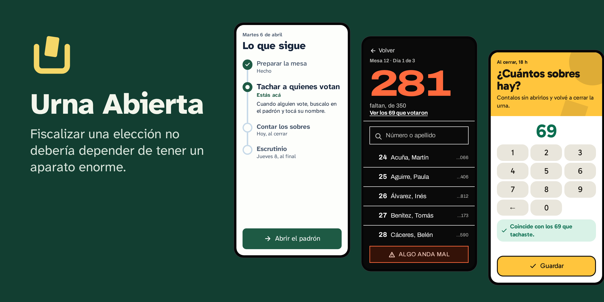

<div align="center">


# Urna Abierta

**La app libre para organizar a los fiscales de tu partido, en cualquier elección.**<br>
[English](README.en.md) · [Sitio](https://bafif.github.io/urna-abierta/) · [Instalar](#instalar) ·
[Tu primera elección](docs/es/primera-eleccion.md)

</div>

Cada partido la instala en su propio servidor. Los fiscales entran con un link, tachan a quienes votan aunque no haya
señal, avisan si algo anda mal y cargan el escrutinio con la foto del acta; el jefe de distrito ve primero las mesas que
lo necesitan. Alcanza con una app gratuita, un servidor propio y un rato de configuración: no hace falta la estructura
de un partido grande.

<p align="center"></p>

## Por qué Urna Abierta

- **Tus datos, en tu servidor.** Cada partido usa el suyo. El proyecto no aloja ni recibe nada: no hay servidor central
  ni telemetría.
- **Anda sin señal.** Todo se guarda primero en el teléfono y se manda solo cuando vuelve la señal. Si un aviso urgente
  no sale, la app ofrece llamar al jefe o escribirle por WhatsApp o SMS.
- **La entiende quien nunca la abrió.** Una pregunta por pantalla, un botón principal y un plan que dice qué sigue. Cada
  persona ve solo su trabajo, en el tema y el idioma que elija.
- **Pensada para no pagar servidor.** Apunta a los planes gratuitos: con 1 GB de memoria y un cuarto de procesador,
  anduvo con 200 mesas en una [prueba de laboratorio](docs/es/resultados-etapa-4.md).
- **Lee tus padrones.** Una planilla de Excel o CSV se sube directo. Un PDF escaneado pasa antes por el
  [lector de padrones](https://github.com/bafif/urna-abierta-padrones), que lo lee en tu computadora sin mandarlo a
  nadie.
- **Con la ley argentina en mente.** Permisos por tarea, un registro que nadie puede cambiar y herramientas para atender
  los pedidos de las personas y borrar los datos al terminar. Cumplir la ley sigue siendo responsabilidad del partido.

## Quién hace qué

| Tarea | Qué hace |
|---|---|
| **Fiscal** | Entra con un link, tacha a quienes votan aunque no haya señal, cuenta los sobres cada noche y carga el escrutinio |
| **Jefe de distrito** | Ve primero las mesas que lo necesitan, y llama a su fiscal con un toque |
| **Coordinación** | Arma una vez el partido y el equipo, y crea una elección cada vez que hace falta |
| **Semáforo** | Arma las categorías de su partido y anota a cada persona en una; cada vez que mira una sensible, queda registrado |
| **Estadísticas** | Ve cuántos votaron, nunca un nombre |

## Instalar

**Todavía no hay una versión publicada.** Cuando la haya, el instalador para Windows, macOS o Linux se baja de la página
de releases: hace tres preguntas, crea tu servidor y deja todo configurado.

Mientras tanto, se prueba desde el código, con Node 26 y Podman:

```sh
git clone https://github.com/bafif/urna-abierta && cd urna-abierta
corepack pnpm install
deploy/serve.sh        # la app con personas inventadas: un link para cada tarea
deploy/instalador.sh   # o el instalador, para probarla en esta computadora
```

[Instalación](docs/es/instalacion.md) tiene el detalle: cada opción del instalador, cómo cargar el padrón y qué servidor
elegir.

## Cómo se usa

1. **Instalala.** El instalador pregunta dónde va a vivir (un servidor nuevo en Oracle, AWS o Google, uno que ya
   tengas, un texto para pegar al crearlo o esta computadora), cómo leer los padrones y cómo se ve. Al terminar te da la
   dirección y una llave de recuperación para las copias de seguridad.
2. **Armá el partido y el equipo.** La app te recibe con un asistente. Sumás a cada persona con su tarea y le mandás su
   link por WhatsApp o como quieras.
3. **Creá la elección.** Días, listas, padrón, mesas y fiscales, un paso por pantalla.
4. **El día de la votación,** los fiscales tachan y el panel muestra primero las mesas que necesitan algo. Al final se
   carga el escrutinio, se cierra la elección y se borran los datos personales.

Todo el recorrido, y qué hacer si algo falla, está en [Tu primera elección](docs/es/primera-eleccion.md). Antes de
usarla en una elección de verdad, hacé un [simulacro](docs/es/simulacro.md).

## Estado

Está en desarrollo y todavía no se usó en una elección real.

- **Probado:** una elección entera, de punta a punta, en Chrome de Android y en WebKit contra el servidor real; un
  Android en un emulador, sin señal, reiniciado y sin espacio; el servidor con los límites de un plan gratuito; y la
  instalación por SSH en Alpine y en Ubuntu, con copias, actualizaciones, restaurar en otro servidor y reiniciar.
- **Sin probar todavía:** crear servidores en las nubes reales (se probó contra simulaciones de sus API), el
  certificado para una IP, el texto pegado de punta a punta en Alpine, la instalación en otros Linux, el instalador en Windows y macOS de verdad
  (en cada cambio se arma y se arranca en la integración continua), un iPhone real y el simulacro con personas. El
  detalle está en [Qué se probó, y qué falta](docs/es/resultados-etapa-4.md).

## Más documentación

- [Instalación](docs/es/instalacion.md): el instalador, cada opción, cargar el padrón y qué servidor elegir.
- [Crear un servidor](docs/es/servidores.md): Oracle, AWS y Google paso a paso, las copias, actualizar y restaurar.
- [Tu primera elección](docs/es/primera-eleccion.md): de la instalación a borrar los datos, y qué hacer si algo falla.
- [Simulacro](docs/es/simulacro.md): qué probar con personas de verdad antes de una elección.
- [Datos personales](docs/es/datos-personales.md): qué pide la ley, cómo inscribir la base y cómo atender cada pedido.
- [Información legal](LEGAL.md): licencia, responsabilidades y datos personales.
- [Tu propio tema](docs/es/temas.md): los colores de tu partido, siempre que se puedan leer.
- [Comprobar la descarga](docs/es/comprobar-descarga.md): el SHA-256 y la atestación del instalador.
- [Prueba en un teléfono](docs/es/pruebas-en-telefonos.md): Android en un emulador, y la prueba pendiente en iPhone.
- [Plan técnico](docs/es/plan-tecnico.md): arquitectura, sincronización, permisos, formato de padrón y etapas.
- [Qué se probó, y qué falta](docs/es/resultados-etapa-4.md), con los
  [riesgos iniciales](docs/es/resultados-etapa-1.md).
- [Publicar una versión](docs/es/publicar.md): qué hace GitHub Actions con cada versión.
- [Cómo contribuir](CONTRIBUTING.md): las pruebas, los idiomas y cómo se trabaja.
- [Seguridad](SECURITY.md): cómo avisar de una falla, en privado.
- [Lector de padrones](https://github.com/bafif/urna-abierta-padrones): el repo que convierte padrones al formato
  abierto.

## Autor

Lo hago yo, **Bautista D. Fiori**, como proyecto personal: no pertenece a ningún partido ni agrupación. Si querés usarla
en tu elección o sumarte, escribime: [LinkedIn](https://www.linkedin.com/in/b-d-fiori/) ·
[GitHub](https://github.com/bafif).

## Licencia

[AGPL-3.0-or-later](LICENSE). Podés usarla, modificarla y compartirla; si ofrecés una versión modificada por red, tenés
que ofrecer también su código.
